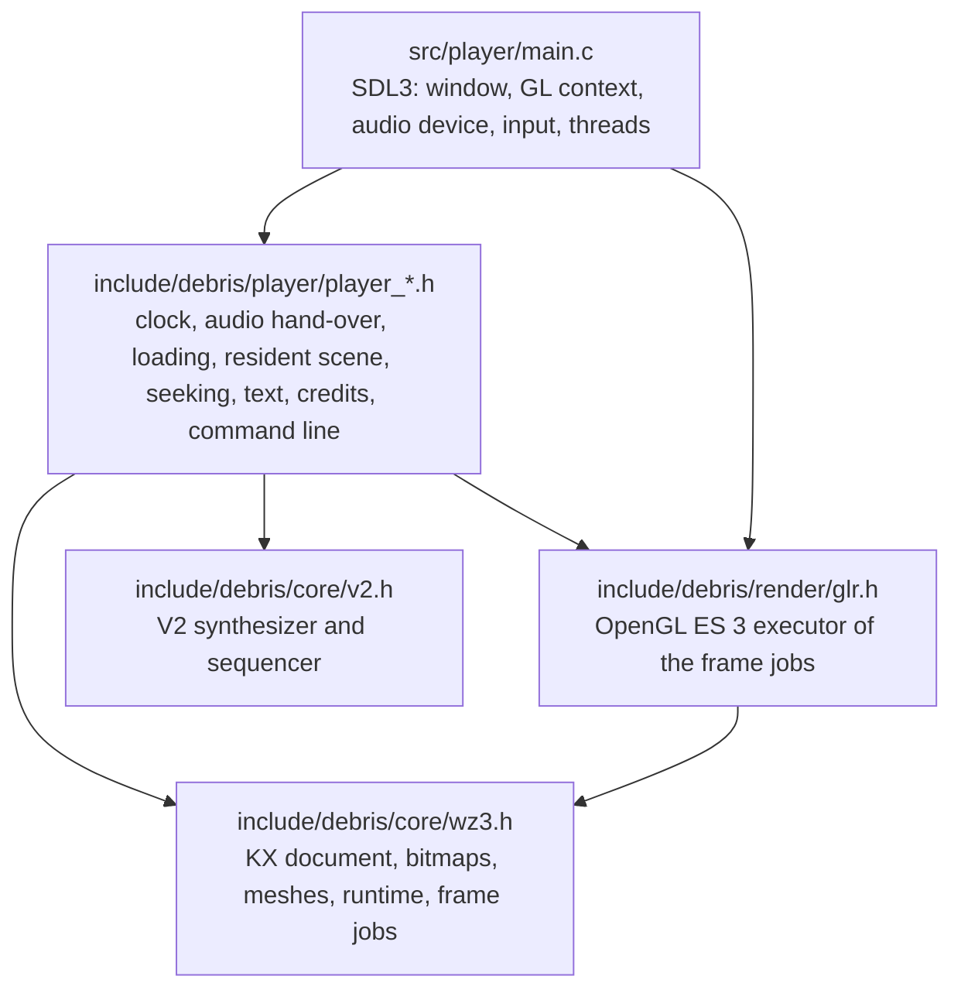

# Architecture

## Layers

Everything below `main.c` is free of platform code: no window, no OpenGL loader, no audio device, no threads, no file access
beyond what the caller hands in. The platform seam is small and lives in `main.c`: it creates the window and the GL context,
passes `SDL_GL_GetProcAddress` to `glr_create`, feeds the audio device from `paudio_render`, and runs the loading worker thread.

| Header | Role |
|---|---|
| `core/v2.h` | V2 module (`.v2m`, format version 6) player: `v2_open`, `v2_play`, `v2_render`. Pull based, any chunk size gives the same bits. |
| `core/wz3.h` | The werkkzeug3 layers the demo uses, from the compact KX document to the semantic per-frame jobs. Nothing touches a GPU. |
| `render/glr.h` | Executes the frame jobs of `wz3.h` through a function table that the host fills with its GL loader (`glr_loader_fn`). Owns no window or context. |
| `player/player_core.h` | `pclock` (visual clock that follows the audio device) and `paudio` (loader tune, hand-over to the party song, seeking). |
| `player/player_load.h` | Host side of the precalculation: geometry sink, progress, cancellation. |
| `player/player_scene.h` | What the player keeps resident for the renderer: geometry, shadow data, the texture plan, warm-up in slices. |
| `player/player_replay.h` | Snapshots of the runtime and the replay behind a backward seek. |
| `player/player_text.h`, `player_credits.h` | Text for the player's own screens, credits and licences. |
| `player/player_args.h` | The command line and the script of `--script`. |
| `player/player_glcheck.h` | GL object accounting for `--gl-check` and the soak. |

## Single-header convention

`v2.h`, `wz3.h`, `glr.h` and the `player_*.h` headers follow the stb pattern:

* Including a header declares the API. Defining `<NAME>_IMPLEMENTATION` before the include, in exactly one translation unit,
  also compiles the implementation. `main.c` does this for all of them; the test suites do it for the libraries they test.
* `<NAME>_STATIC` (`V2_STATIC`, `WZ3_STATIC`, `GLR_STATIC`, `PLAYER_CORE_STATIC`, ...) makes every API function `static`, which gives a
  translation unit a private copy. The test runner uses this so that many suites can live in one program.
* `V2_MALLOC`/`V2_FREE` and `WZ3_MALLOC`/`WZ3_FREE` replace the allocator; `V2_RONAN=0` leaves out the Ronan speech synthesizer.
* No header has mutable global state, and a CTest check (`headers_no_mutable_statics`) keeps it that way. Every function works on an
  object that the caller owns, so any number of instances can coexist; an instance is used by one thread at a time.
* Errors are return codes (`v2_result`, `wz3_result`, `glr_result`) or `NULL`; nothing uses exceptions or `longjmp`.

`wz3.h` is large, so its implementation is split into the fragments of [include/debris/core/wz3](../include/debris/core/wz3),
included by `wz3.h` in a fixed order (`10_` to `99_`). The file `wz3.h` itself is the public interface and the documentation of it.

## From the document to the picture

1. `wz3_kx_parse` reads the compact KX document (the operator graph, the animation bytecode, the events and the two V2 songs).
2. `wz3_rt_precalc` evaluates every operator once. The host receives the meshes and bitmaps through a sink (`player_load.h`
   keeps the 574 meshes a scene draws and drops the generator intermediates), and can cancel between operators.
3. `pscene_*` plans the textures the materials sample, evaluates them (the Render operators draw through `glr`) and uploads
   geometry and textures in slices, so that the loading screen keeps moving.
4. Every frame, `wz3_rt_frame_at_sample` advances the runtime to the song position and produces the frame jobs (`wz3_frame`):
   viewports, lights, materials, draw lists, effects. `glr_render_frame` executes them.
5. The visual clock follows the audio: `paudio` counts the frames put into the device, `pclock` subtracts what is still queued
   and the device latency, and extrapolates between callbacks.

Seeking backward restores the nearest snapshot (taken every 30 s) and replays the runtime at the deterministic 30 fps cadence up
to the target, because the stateful effects (chain lines, water) depend on every time slice.

## Threads

| Thread | Does |
|---|---|
| main | window, input, GL calls, loading screen, uploads, drawing |
| worker | `wz3_rt_precalc` and the texture evaluation while loading; joined before the party starts |
| audio (SDL) | `audio_callback` calls `paudio_render` |

The worker never calls OpenGL. Progress and cancellation travel through `SDL_AtomicInt`; the audio callback and the main
thread meet at `SDL_LockAudioStream`.

## Determinism

The pictures and the sound are checked against the original arithmetic, so:

* strict binary32 arithmetic: `-ffp-contract=off` (MSVC: `/fp:precise`), never `-ffast-math`, `FLT_EVAL_METHOD == 0`;
* the transcendental functions (`sin`, `cos`, `atan`, `log`, `pow`, ...) are fdlibm ports inside `wz3.h` and `v2.h`, bit-exact with
  the reference, instead of the platform's libm (`no_libm_imports` checks the executable);
* the x87 of the original runs in single precision with round-to-nearest-even; the code reproduces every rounding point
  and spells the MMX word arithmetic of the bitmap operators out lane by lane;
* output does not depend on the chunk size of the audio callback or on the frame rate of the display.

## Where the web build will touch this code

The headers need no change. In `main.c` the following have no direct equivalent in a browser and are the places to adapt:

* the main loop: a browser needs a frame callback instead of a loop that blocks until the demo ends;
* the loading worker: threads need cross-origin isolation, otherwise `wz3_rt_precalc` has to run in slices on the main thread
  (the host sink and the cancel callback already allow that);
* file access: the assets are read with `fopen` next to the executable;
* the GL context request (OpenGL ES 3.0 is tried first and works as it is) and `SDL_GL_GetProcAddress` for the loader;
* the soak, the `/proc` based memory probe and the other measurement options are native-only.

The plan for the web build (SDL3 with Emscripten, OpenGL ES 3 as WebGL 2) is `wasm_c99_port_fr_041_port_plan.md` in the reference repository.
